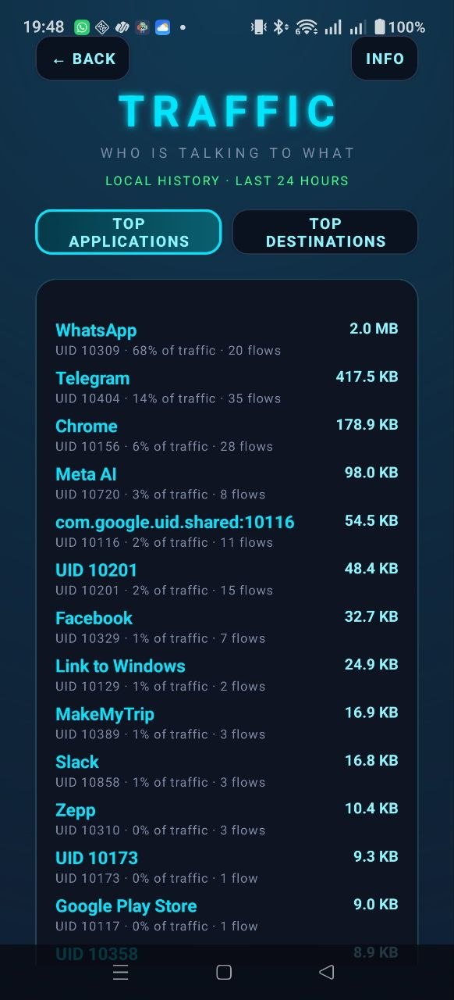
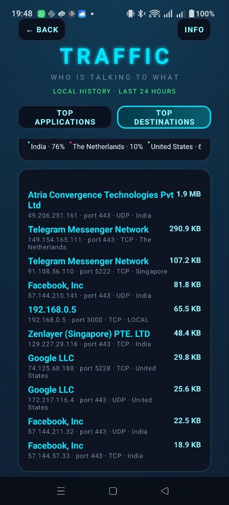
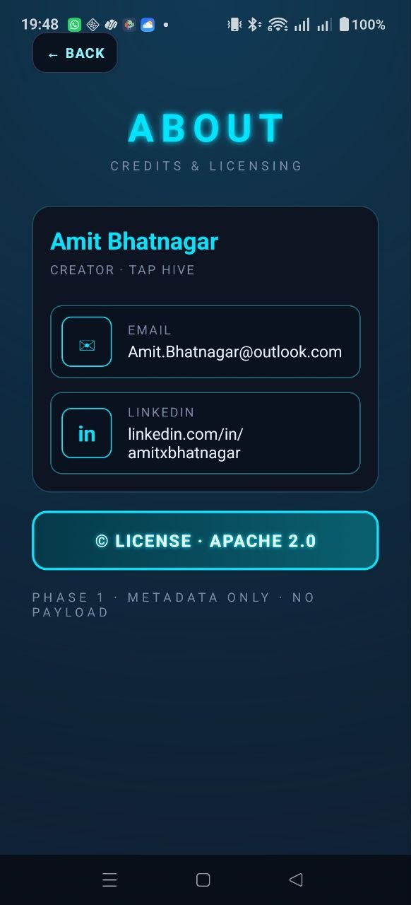

# TapHive

TapHive is a clean-room Android app that captures **network flow metadata** on a local VPN interface and forwards it as structured **RFC 3164 + JSON syslog events** for SIEM ingestion.

> **Phase 1 status:** MVP complete and device-verified. Metadata only — no payload, DNS names, L7/HTTP inspection, pcap files, root, companion addon, firewall, geo/ASN, or external API.

## Highlights

- Local `VpnService` with IPv4 split routes, transparent TCP/UDP forwarding, and a persistent foreground notification. IPv6 routing is deferred until the forwarder supports it.
- Pure Kotlin `PacketReader` over the VPN fd: IPv4/IPv6 headers, TCP/UDP/SCTP ports, canonical flow keys, 30-second idle expiry. With IPv6 routes removed, live capture currently sees IPv4 only.
- Numeric uid attribution through `ConnectivityManager.getConnectionOwnerUid`; no package-visibility permission in Phase 1.
- Syslog forwarding over UDP or TCP, disabled by default, with facility/severity settings, bounded queue, rate limiting, and reconnect backoff.
- Syslog socket is bound to the underlying Wi-Fi/cellular/Ethernet network so it never loops back into TapHive's own tunnel. Captured TCP/UDP traffic is relayed through protected sockets on that network and rewritten back into the tun, so device connectivity is preserved.
- Dark neon UI with live capture state, pulsing status indicator, sender-error display, and aggregate counters.
- Live counters show raw packets captured from the VPN fd and syslog events successfully forwarded; the same totals are included on `capture_start`/`capture_stop` events.
- No third-party runtime dependencies; only the Android Gradle plugin and Kotlin plugin are used at build time.

## Screenshots

<table>
  <tr>
    <td></td>
    <td></td>
    <td></td>
  </tr>
  <tr>
    <td align="center">Main</td>
    <td align="center">Traffic by application</td>
    <td align="center">Top destinations</td>
  </tr>
  <tr>
    <td></td>
    <td></td>
    <td></td>
  </tr>
  <tr>
    <td align="center">Syslog target</td>
    <td align="center">About</td>
    <td></td>
  </tr>
</table>

## Architecture

```text
Device traffic
    │
    ▼
VpnService tun fd
    │
    ├──► PacketReader (Kotlin) ──► Flow registry + UidResolver ──► SyslogSender ──► UDP/TCP 514 ──► SIEM
    │
    └──► Ipv4TunnelForwarder ──► protected TCP/UDP sockets ──► underlying network
             └──► rewritten replies written back to the tun fd
```

Key source files:

```text
app/src/main/java/com/taphive/app/
├── TapHiveApp.kt        # singleton prefs + syslog sender
├── MainActivity.kt      # dark neon UI, start/stop/settings
├── SettingsActivity.kt  # syslog target configuration
├── CaptureService.kt    # VpnService lifecycle + flow sink
├── PacketReader.kt      # Kotlin IP/transport parser + flow tracking
├── Ipv4TunnelForwarder.kt # transparent IPv4 TCP/UDP NAT back to the real network
├── TunWriter.kt         # synchronized tun packet writer
├── IpPacket.kt          # shared endpoint/packet model
├── UidResolver.kt       # numeric uid attribution
├── SyslogSender.kt      # RFC 3164 formatter, queue, rate limit, sockets
├── SyslogEvent.kt       # th_* JSON schema v2
└── Prefs.kt             # SharedPreferences-backed settings
```

## Syslog event contract

RFC 3164 header:

```text
<PRI>MMM dd hh:mm:ss HOST APP[PID]:
```

- Facility default: `local0` (13)
- Lifecycle severity: `NOTICE` (5) → `PRI 109`
- Flow severity: `INFO` (6) → `PRI 110`

Example flow event:

```json
{
  "th_schema_version": 2,
  "th_session_id": "e5a53bfb-9fab-40d6-aefb-5959535302fa",
  "th_event": "flow_open",
  "th_timestamp": "2026-11-20T17:28:03.997Z",
  "th_flow_id": "1",
  "th_uid": 10194,
  "th_ip_version": 4,
  "th_protocol": 6,
  "th_src_ip": "10.0.0.2",
  "th_src_port": 52864,
  "th_dst_ip": "1.1.1.1",
  "th_dst_port": 443,
  "th_bytes_sent": 0,
  "th_bytes_received": 0,
  "th_packets_sent": 0,
  "th_packets_received": 0
}
```

Event types: `capture_start`, `flow_open`, `flow_close`, `capture_stop`. All events share `th_schema_version` and `th_session_id`; null optional fields are omitted.

Lifecycle events also carry the aggregate counters:

```json
{
  "th_schema_version": 2,
  "th_event": "capture_stop",
  "th_packets_captured": 1842,
  "th_events_forwarded": 61
}
```

The UI shows the same values as `PACKETS n · FORWARDED n`. These are counts only — no packet payloads are emitted.

## Build

Requirements:

- JDK 21
- Android SDK platform 36
- Gradle 8.9 via the included wrapper
- No NDK or CMake required

Create `local.properties` in the project root (it is gitignored):

```properties
sdk.dir=/path/to/your/Android/sdk
```

Then build:

```sh
./gradlew :app:assembleDebug
```

The APK is written to:

```text
app/build/outputs/apk/debug/app-debug.apk
```

Android Gradle Plugin 8.7.3 prints a warning that it was tested up to `compileSdk 35`; the build succeeds against installed platform 36.

## Install and test

```sh
adb connect <device-ip>:<adb-port>
adb -s <device-ip>:<adb-port> install -r app/build/outputs/apk/debug/app-debug.apk
adb -s <device-ip>:<adb-port> shell am start -n com.taphive.app/.MainActivity
```

In the app:

1. Open **Settings**.
2. Enable syslog forwarding.
3. Set host, port, transport (`UDP`/`TCP`), and facility.
4. Save.
5. Tap **START CAPTURE** and grant the VPN consent prompt.

The status card should show `CAPTURE LIVE` and the configured syslog target.

A minimal UDP test receiver:

```python
import socket

sock = socket.socket(socket.AF_INET, socket.SOCK_DGRAM)
sock.bind(("0.0.0.0", 1514))
with open("taphive-syslog.log", "ab", buffering=0) as out:
    while True:
        data, _ = sock.recvfrom(65535)
        out.write(data + b"\n")
```

`nc -u` is not recommended on macOS because it can stop after the first datagram.

### Verification performed

On a CPH2585 running Android 16 (API 36), a clean UDP run produced:

- `1 × capture_start`
- `13 × flow_open`
- `13 × flow_close` with final byte/packet counters
- `1 × capture_stop`

`capture_stop` carried `th_packets_captured: 33` and `th_events_forwarded: 27`; the UI showed `PACKETS 33 · FORWARDED 28` after the stop event itself was forwarded. All events reached the receiver with matching session ids and `th_schema_version: 2`. TCP forwarding is implemented with reconnect/backoff but was not exercised in that final run.

## Privacy and permissions

Collected: IP endpoints, IP version, protocol, ports, numeric uid, byte/packet counters, timestamps, flow lifecycle status.

Not collected: packet payloads, DNS names, URLs, HTTP bodies, TLS secrets, device identifiers beyond the RFC 3164 host field, package labels/icons.

Syslog is cleartext in Phase 1: use a trusted receiver network. TLS and RFC 5424 are deliberately deferred.

## Scope and roadmap

Phase 1 is intentionally narrow: capture → syslog → SIEM. See [`BUILDPLAN.md`](BUILDPLAN.md) for phase ownership and deferred items such as per-app labels, protocol/DNS inspection, geo/ASN, pcapng, companion addon, firewall, backup/restore, and external APIs.

## License

Licensed under the Apache License, Version 2.0. See [`LICENSE`](LICENSE) and [`NOTICE`](NOTICE).
