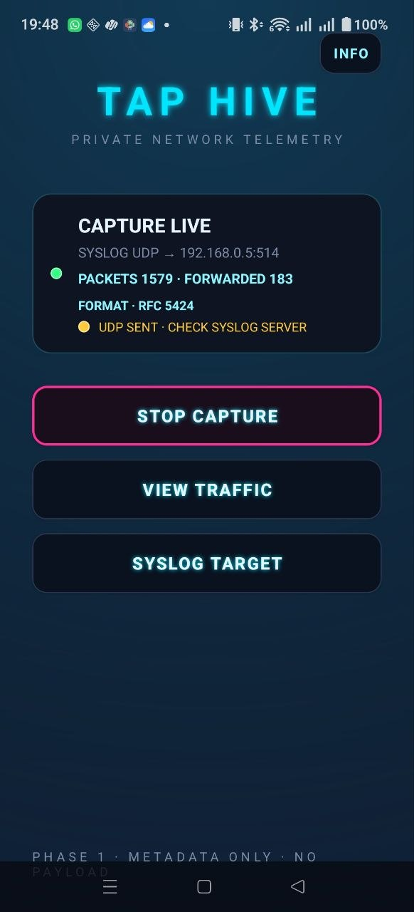
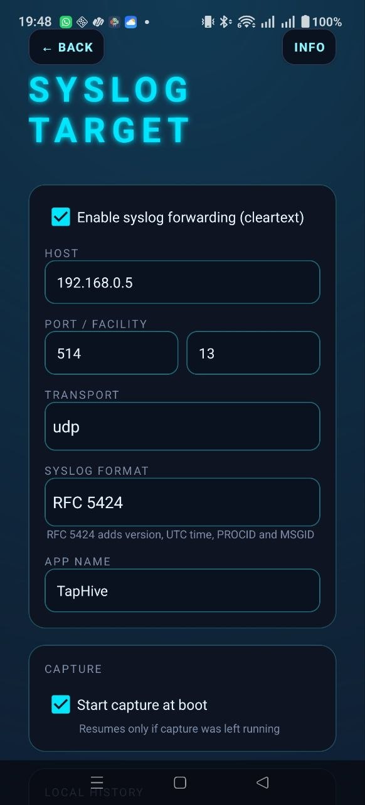

# TapHive

TapHive is a clean-room Android app that captures **network flow metadata** on a local VPN interface and forwards it as structured **RFC 3164 or RFC 5424 JSON syslog events**. It also keeps a configurable local history with per-app and destination enrichment.

> **v1.1 status:** release-signed, device-verified on Android 16, and hardened incrementally from v1.0. Metadata only — no payload, L7/HTTP inspection, pcap files, root, companion addon, or firewall.

**Prebuilt APK:** [`TapHive-1.1.apk`](https://github.com/bamit99/TapHive/releases/download/v1.1/TapHive-1.1.apk) (release-signed). See [`CHANGELOG.md`](CHANGELOG.md) for the hardening record.

## Highlights

- Local `VpnService` with IPv4 split routes, transparent TCP/UDP forwarding, and a persistent foreground notification. IPv6 routing is deferred until the forwarder supports it.
- Pure Kotlin `PacketReader` over the VPN fd: IPv4/IPv6 headers, TCP/UDP/SCTP ports, canonical flow keys, 30-second idle expiry. With IPv6 routes removed, live capture currently sees IPv4 only.
- Numeric UID attribution through `ConnectivityManager.getConnectionOwnerUid`; UID labels come from `PackageManager` without `QUERY_ALL_PACKAGES`. Unknown/negative UIDs are shown as `MISC`.
- Syslog forwarding over UDP, TCP, or TLS, disabled by default, with facility/severity settings, bounded queue, rate limiting, reconnect backoff, and a choice of RFC 3164 or RFC 5424 framing.
- TLS syslog uses the platform trust store and hostname verification; a TLS failure is surfaced as a certificate error and never silently downgrades to plaintext.
- External destination enrichment is explicit opt-in (default off), uses HTTPS (`ipwho.is`), and sends only the public destination IP. On-device DNS names remain local.
- Syslog and enrichment sockets are bound to the current non-VPN default network so they never loop back into TapHive's own tunnel. Captured TCP/UDP traffic is relayed through protected sockets on that network and rewritten back into the tun, so device connectivity is preserved.
- Main screen shows the active syslog format and a target-health indicator: green only with proof (`TCP` connect), yellow for normal/unconfirmed UDP or stale traffic, red for hard errors, dim when forwarding is disabled.
- Retained local history in SQLite with retention `Off / 1 hour / 6 hours / 24 hours / 7 days` (default `24 hours`), plus a **Clear history** action.
- TRAFFIC view backed by retained history: pie charts by application and country, top applications, and top destinations grouped by IP/port/protocol/UID.
- Destination labels combine on-device DNS answers with optional HTTPS `ipwho.is` country/organisation metadata. DNS is best-effort; the organisation label is the fallback when no name was observed.
- Capture resumes after process death when it was left running. Boot resume is opt-in and requires both **Start capture at boot** and capture previously left running.
- Android 12+ data-extraction rules exclude the history DB and preferences from cloud backup and device transfer; legacy full backup is disabled.
- SQLite uses a non-destructive v2 migration, WAL, and indexes; history writes are queued off the packet thread and TRAFFIC queries run off the UI thread.
- No third-party runtime dependencies; JUnit/AndroidX test libraries are test-only.

## Screenshots

<table>
  <tr>
    <td></td>
    <td></td>
    <td></td>
  </tr>
  <tr>
    <td align="center">Main</td>
    <td align="center">Syslog target</td>
    <td align="center">About</td>
  </tr>
</table>

Traffic screenshots are intentionally omitted from the public repository because they contain real app/destination usage data. They can be regenerated from controlled demo data.

## Architecture

```text
Device traffic
    │
    ▼
VpnService tun fd
    │
    ├──► PacketReader ──► flow_open / flow_close ──► SyslogSender ──► UDP/TCP ──► SIEM
    │        │
    │        ├──► UidResolver ──► AppNameResolver
    │        ├──► TrafficDatabase (retained flows + ip_meta)
    │        ├──► DnsNameParser (port 53 A/AAAA answers)
    │        └──► IpGeoResolver (optional HTTPS country/org/isp/as)
    │
    └──► Ipv4TunnelForwarder ──► protected TCP/UDP sockets ──► underlying network
             └──► rewritten replies written back to the tun fd
```

Key source files:

```text
app/src/main/java/com/taphive/app/
├── TapHiveApp.kt        # application singletons, startup resume
├── MainActivity.kt      # capture UI, format and target health
├── TrafficActivity.kt   # history charts and top lists
├── SettingsActivity.kt  # syslog, format, retention, boot opt-in
├── AboutActivity.kt     # credits and license
├── CaptureService.kt    # VpnService lifecycle + flow sink
├── BootReceiver.kt      # opt-in boot resume
├── PacketReader.kt      # Kotlin IP/transport parser + flow tracking
├── Ipv4TunnelForwarder.kt # transparent IPv4 TCP/UDP NAT
├── TunWriter.kt         # synchronized tun packet writer
├── IpPacket.kt          # shared endpoint/packet model
├── UidResolver.kt       # numeric uid attribution
├── AppNameResolver.kt   # UID -> package/app label
├── DnsNameParser.kt     # A/AAAA answers from DNS responses
├── IpGeoResolver.kt     # optional HTTPS country/org enrichment
├── TrafficDatabase.kt   # retained flow history + IP metadata
├── TrafficTracker.kt    # live flow aggregation
├── SyslogSender.kt      # RFC 3164/5424 formatter, queue, sockets
├── SyslogEvent.kt       # th_* JSON schema v2
└── Prefs.kt             # SharedPreferences-backed settings
```

## Local history and enrichment

- Flow history is stored in SQLite as `ts, uid, ip, port, protocol, bytes`.
- Retention is selectable in **SYSLOG TARGET → LOCAL HISTORY**:
  - `Off`
  - `1 hour`
  - `6 hours`
  - `24 hours` (default)
  - `7 days`
- Pruning runs at startup, on writes (throttled), and when settings are saved. **CLEAR HISTORY** removes flows and cached IP metadata.
- `TrafficDatabase` keeps an `ip_meta` cache with country, organisation, DNS name, and update time.
- DNS names are parsed locally from A/AAAA answers seen in plaintext DNS responses on port 53. DNS-over-HTTPS/TLS bypasses this and will not produce a name.
- External enrichment is opt-in and off by default. When enabled, public destination IPs are sent over HTTPS to `ipwho.is`; UID, ports, DNS names, and local history are not sent.
- Private, loopback, link-local, CGNAT, and RFC 1918 addresses are labelled `LOCAL` and are not sent to the provider.
- Lookup attempts are rate-limited and cached. When local history is Off, `ip_meta` is cleared and DNS/geo persistence is skipped.

## Main-screen target status

The main card shows `FORMAT · RFC 3164` or `FORMAT · RFC 5424`, plus a coloured target indicator:

| State | Meaning |
| --- | --- |
| Green — `LISTENER CONFIRMED · TCP` | A TCP connection (or TLS handshake, for the TLS transport) succeeded. This is the only positive listener proof available. |
| Yellow — `UDP SENT · CHECK SYSLOG SERVER` | UDP datagrams were sent, but UDP has no acknowledgement. |
| Yellow — `NO RECENT PACKETS · CHECK SERVER` | No successful send within the last 60 seconds. |
| Red — `CHECK SERVER / PORT` | DNS failure, TCP refusal/timeout, ICMP port-unreachable, or repeated send backoff. |
| Dim — `SYSLOG DISABLED` | Forwarding is off. |

For UDP, TapHive uses a connected `DatagramSocket` so an ICMP port-unreachable response can surface as a real failure without sending an extra probe. A recent UDP refusal stays red for 60 seconds because a fresh socket can send once before the next ICMP error arrives.

## Syslog event contract

RFC 3164 header:

```text
<PRI>MMM dd hh:mm:ss HOST APP[PID]: JSON
```

Example:

```text
<110>Nov 26 16:47:20 SM-P615 TapHive[20305]: {"th_schema_version":2,...}
```

RFC 5424 header:

```text
<PRI>1 RFC3339 HOST APP PROCID MSGID - JSON
```

Example:

```text
<110>1 2026-11-26T11:15:13.845Z SM-P615 TapHive 20305 flow_close - {"th_schema_version":2,...}
```

- Facility default: `local0` (13)
- Lifecycle severity: `NOTICE` (5) → `PRI 109`
- Flow severity: `INFO` (6) → `PRI 110`
- RFC 5424 uses the event name as `MSGID`, the process id as `PROCID`, and `-` for structured data. The JSON remains in `MSG`.
- TCP syslog uses newline framing.

Example flow event:

```json
{
  "th_schema_version": 2,
  "th_session_id": "e5a53bfb-9fab-40d6-aefb-5959535302fa",
  "th_event": "flow_open",
  "th_timestamp": "2026-11-20T17:28:03.997Z",
  "th_flow_id": "1",
  "th_uid": 10194,
  "th_ip_version": 4,
  "th_protocol": 6,
  "th_src_ip": "10.0.0.2",
  "th_src_port": 52864,
  "th_dst_ip": "1.1.1.1",
  "th_dst_port": 443,
  "th_bytes_sent": 0,
  "th_bytes_received": 0,
  "th_packets_sent": 0,
  "th_packets_received": 0
}
```

Event types: `capture_start`, `flow_open`, `flow_close`, `capture_stop`. All events share `th_schema_version` and `th_session_id`; null optional fields are omitted.

**Application ↔ destination correlation:** `flow_open` carries both `th_uid` and the destination tuple (`th_dst_ip`, `th_dst_port`, `th_protocol`). `flow_close` carries the same `th_flow_id` plus byte/packet totals. Join the two events on `(th_session_id, th_flow_id)` to attribute a closed flow to an application and destination.

The syslog payload intentionally contains the raw UID, IP, port, and protocol. Country, DNS name, organisation, and human-readable app labels are local enrichment only; they are not added to syslog. Resolve `th_uid` with `PackageManager` on the device, or join against your own app inventory.

Lifecycle events also carry aggregate counters:

```json
{
  "th_schema_version": 2,
  "th_event": "capture_stop",
  "th_packets_captured": 1842,
  "th_events_forwarded": 61
}
```

The UI shows the same values as `PACKETS n · FORWARDED n`. These are counts only — no packet payloads are emitted.

## Capture lifecycle

- **START CAPTURE** requests VPN consent, then starts the foreground `VpnService`.
- **STOP CAPTURE** clears the persisted `capture_wanted` flag and stops the service.
- If the process is killed while capture was left running, launching the app resumes capture.
- **Start capture at boot** only takes effect when capture was also left running. Otherwise a reboot does not silently start the VPN.
- Android may clear the prepared VPN state after a reboot; if resume fails, open TapHive and approve the VPN prompt once.
- The app asks once for battery-optimisation exemption because aggressive background limits can kill long-running capture.

## Build

Requirements:

- JDK 21
- Android SDK platform 36
- Gradle 8.9 via the included wrapper
- No NDK or CMake required

Create `local.properties` in the project root (it is gitignored):

```properties
sdk.dir=/path/to/your/Android/sdk
```

Then build and test:

```sh
./gradlew :app:assembleDebug
./gradlew :app:testDebugUnitTest
./gradlew :app:connectedDebugAndroidTest   # requires a connected device
```

Debug APK:

```text
app/build/outputs/apk/debug/app-debug.apk
```

Release signing is intentionally not committed. Add these gitignored `local.properties` keys and keep the keystore outside the repo:

```properties
taphive.storeFile=/absolute/path/to/taphive-release.jks
taphive.storePassword=...
taphive.keyAlias=taphive
taphive.keyPassword=...
```

Then:

```sh
./gradlew :app:assembleRelease
```

The signed release APK is `app/build/outputs/apk/release/app-release.apk`. Version metadata is `versionName 1.1`, `versionCode 2`. Android Gradle Plugin 8.7.3 prints a warning that it was tested up to `compileSdk 35`; the build succeeds against installed platform 36.

## Install and configure

```sh
adb connect <device-ip>:<adb-port>
adb -s <device-ip>:<adb-port> install -r app/build/outputs/apk/release/app-release.apk
adb -s <device-ip>:<adb-port> shell am start -n com.taphive.app/.MainActivity
```

In the app:

1. Open **SYSLOG TARGET**.
2. Enable **syslog forwarding**.
3. Set host, port, facility, transport (`UDP`/`TCP`/`TLS`), RFC format (`RFC 3164`/`RFC 5424`), and application name.
4. Choose local history retention or disable it.
5. Optionally enable **External IP enrichment (HTTPS)**; leave it off for no third-party lookups.
6. Save.
7. Tap **START CAPTURE** and grant the VPN consent prompt.

The status card should show `CAPTURE LIVE`, the configured target, the selected `FORMAT`, and a target-health indicator.

A minimal UDP test receiver:

```python
import socket

sock = socket.socket(socket.AF_INET, socket.SOCK_DGRAM)
sock.bind(("0.0.0.0", 1514))
with open("taphive-syslog.log", "ab", buffering=0) as out:
    while True:
        data, _ = sock.recvfrom(65535)
        out.write(data + b"\n")
```

`nc -u` is not recommended on macOS because it can stop after the first datagram.

## Device verification

Verified on a CPH2585 phone and SM-P615 tablet running Android 16 (API 36):

- RFC 3164 and RFC 5424 lines received over UDP and TCP.
- TLS syslog failed closed against a self-signed listener with `TLS HANDSHAKE FAILED · CHECK CERTIFICATE`; no plaintext fallback.
- HTTPS enrichment produced country/org rows for public destinations when explicitly enabled.
- `flow_open`/`flow_close` correlation by `th_session_id` + `th_flow_id`.
- TCP listener → green; closed TCP port → red; UDP port-unreachable → red; normal UDP → yellow.
- Android 16 back showed the exit dialog; TRAFFIC back routing and navigation were checked.
- SQLite migrated an existing v1 database to v2 with history preserved.
- Force-stop and relaunch resumed capture when it was left running.
- 14 JVM tests and 2 instrumentation tests passed; release APK verified signed and non-debuggable.

## Privacy and permissions

**Collected locally:** IP endpoints, IP version, protocol, ports, numeric UID, byte/packet counters, timestamps, flow status, DNS names observed on port 53, and country/organisation labels.

**Sent externally:** only when the user enables external enrichment, public destination IPs are sent over HTTPS to `ipwho.is` to obtain country/org/isp/as. The provider can see the device's source IP. The configured syslog receiver receives metadata events; choose TLS for an authenticated, encrypted transport. No API key is used.

**Not collected:** packet payloads, URLs, HTTP bodies, TLS secrets, or device identifiers beyond the RFC 3164/5424 host field. App labels, DNS names, and enrichment labels are local and are not added to syslog.

**Not backed up:** `android:allowBackup="false"` plus `dataExtractionRules` excludes the history database and preferences from cloud backup and device transfer. History is still plaintext inside the app's private sandbox.

Permissions declared:

- `INTERNET`, `ACCESS_NETWORK_STATE`
- `FOREGROUND_SERVICE`, `FOREGROUND_SERVICE_SPECIAL_USE`
- `POST_NOTIFICATIONS`
- `RECEIVE_BOOT_COMPLETED`
- `REQUEST_IGNORE_BATTERY_OPTIMIZATIONS`

No `QUERY_ALL_PACKAGES`; package visibility is limited to launcher `MAIN`/`LAUNCHER` queries for UID label resolution.

UDP/TCP syslog are cleartext by design and should only be used on a trusted network. TLS syslog uses the platform trust store and hostname verification; certificate pinning and mTLS are not implemented. External enrichment is HTTPS.

## Scope and roadmap

Current release: metadata capture → retained local history/enrichment → RFC 3164/5424 syslog → SIEM.

Deferred or incomplete: IPv6 forwarding, full TCP retransmission/out-of-order reassembly, TLS pinning/mTLS, history encryption at rest, pcap/pcapng export, firewall controls, companion addon, backup/restore, and L7/HTTP inspection. DNS names are only visible for plaintext DNS on port 53; DoH/DoT remains opaque to the app. See [`CHANGELOG.md`](CHANGELOG.md) and [`docs/SIEM.md`](docs/SIEM.md).

## License

Licensed under the Apache License, Version 2.0. See [`LICENSE`](LICENSE) and [`NOTICE`](NOTICE).
